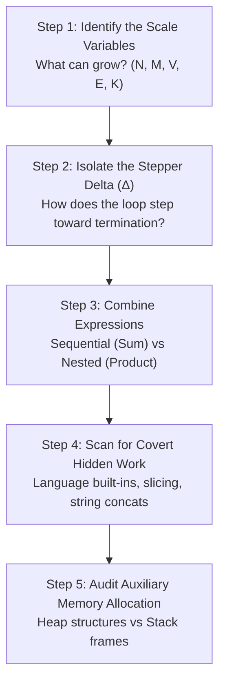
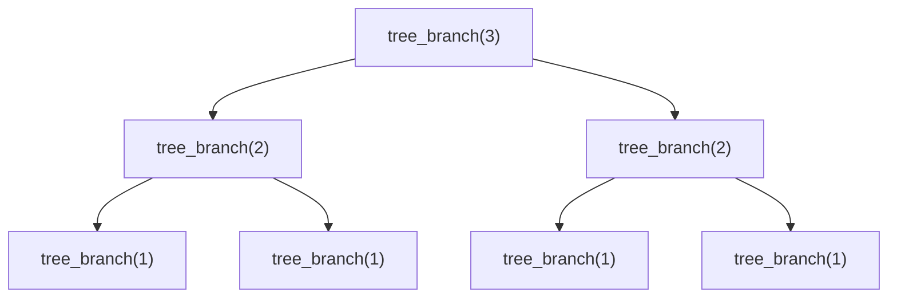

# The Cognitive Mechanics of Big O: Complexity Analysis Engine

> [!abstract] Core Thesis
> Determining computational complexity is not about memorizing algorithm names; it is about **tracking resource consumption as input approaches infinity ($N \to \infty$)**. The mental leap requires ignoring physical time (seconds, clock cycles) and analyzing the **rate of growth of fundamental operations and memory frames** through deductive pattern recognition.

---

## 1. Formal Foundations (Stripped to First Principles)

Before debugging algorithms, calibrate your vocabulary. Industry engineers often say "Big O," but theoretically there are three distinct boundaries:

| Notation | Formal Name | Intuitive Meaning | Mental Anchor |
| :--- | :--- | :--- | :--- |
| $\mathcal{O}(g(n))$ | **Big O** | **Upper Bound** (Worst-case ceiling) | *"It will never be worse than this."* |
| $\Omega(g(n))$ | **Big Omega** | **Lower Bound** (Best-case floor) | *"It will never be faster than this."* |
| $\Theta(g(n))$ | **Big Theta** | **Tight Bound** (Exact match) | *"It runs precisely at this rate."* |

```
Operations (f(n))
  ▲
  │                               / O(g(n)) [Ceiling]
  │                             /
  │                      ======/==== f(n) [Actual runtime]
  │                     /    /
  │                   /    /
  │                 /    /   Ω(g(n)) [Floor]
  │               /    /   /
  │             /    /   /
  └───────────/────/───/──────────────► Input Size (n)
```

> [!important] The Industry Pragmatism Rule
> When interviewers or peers ask *"What is the Big O?"*, they almost universally mean: **"What is the tightest upper bound ($\Theta$ or tight $\mathcal{O}$) on the worst-case input scenario?"**

---

## 2. The 5-Step Deduction Pipeline (The Internal Monologue)

Whenever you encounter unfamiliar code, run this mental audit sequence in order:



### Step 1: Identify the Scale Variables
Never default to blindly using $N$. Ask: **"What levers control the execution duration?"**
- One array: $N = \text{len(arr)}$
- A 2D matrix: $R = \text{rows}, C = \text{cols}$ (Total cells = $R \times C$)
- A graph: $V = \text{vertices}, E = \text{edges}$
- Two strings: $S_1 = \text{len}(s_1), S_2 = \text{len}(s_2)$

### Step 2: Isolate the Stepper Delta ($\Delta$)
Look exclusively at loop counters or recursive parameters. **How do they converge to the end condition?**

| Transition Pattern | Arithmetic Type | Asymptotic Signature |
| :--- | :--- | :--- |
| `i += 1`, `i -= 1` | Linear increment/decrement | $\mathcal{O}(N)$ |
| `i += 2`, `i += 5` | Constant stride | $\mathcal{O}(N)$ *(constants drop)* |
| `i *= 2`, `i /= 2` | Multiplicative / Division | $\mathcal{O}(\log N)$ |
| `i *= i` | Exponential jump | $\mathcal{O}(\log(\log N))$ |

### Step 3: Combine Expressions (Sum Rule vs. Product Rule)
- **Sequential Steps $\to$ Addition:**
  ```python
  do_something(n)  # O(n)
  do_something_else(n)  # O(n^2)
  # Total: O(n + n^2) => Drop non-dominant terms => O(n^2)
  ```
- **Nested Steps $\to$ Multiplication:**
  ```python
  for i in range(n):         # Runs n times
      for j in range(m):     # Runs m times per outer iteration
          action()           # Total: O(n * m)
  ```

### Step 4: Scan for Hidden Built-In Complexity
Language runtimes wrap complex operations in single-character syntax. **Audit every built-in call.**

```python
# Looks like O(N), but is actually O(N^2)!
for item in my_list:       # Runs N times
    if item in other_list: # 'in' on a Python List is an O(M) linear search!
        pass

# Looks like O(N), but is actually O(N * K) or O(N^2)!
result = ""
for char in large_text:    # Strings are immutable; concatenation allocates
    result += char         # a new string of length K each iteration!
```

### Step 5: Audit Auxiliary Space
Ask: **"If input doubled, how much new memory must the machine allocate?"**
- **Input Space:** Memory required to hold input arguments (ignored in *auxiliary* space analysis).
- **Auxiliary Space:** Extra memory created *by the algorithm itself*:
  - **Explicit (Heap):** Hash tables, arrays, cloned buffers.
  - **Implicit (Stack):** Active call frames during recursion.

---

## 3. The Complexity Spectrum: Signposts & Archetypes

```
Complexity Ranking (Best to Worst):
O(1) < O(log N) < O(√N) < O(N) < O(N log N) < O(N^2) < O(2^N) < O(N!)
```

### 3.1 $\mathcal{O}(1)$ — Constant Time
- **Internal Monologue:** *"Does the execution count remain identical whether $N=10$ or $N=10,000,000$?"*
- **Scent:** Array index lookup, hash map `get`/`put` (average case), basic math, stack `push`/`pop`.

### 3.2 $\mathcal{O}(\log N)$ — Logarithmic Time
- **Internal Monologue:** *"At every step, do I discard a fixed percentage (usually half) of the remaining problem?"*
- **The Core Math:** How many times can you divide $N$ by 2 before reaching 1?
  $$2^k = N \implies k = \log_2(N)$$
- **Scent:** Binary search, balanced search tree operations (AVL, Red-Black), binary exponentiation.

```
N = 16  ──(split)──►  8  ──(split)──►  4  ──(split)──►  2  ──(split)──►  1
Total Steps: 4 (since log2(16) = 4)
```

### 3.3 $\mathcal{O}(\sqrt{N})$ — Square Root Time
- **Internal Monologue:** *"Am I testing divisors or stepping through a symmetric pairing space?"*
- **Scent:** Prime checking up to $\sqrt{N}$, block-decomposition algorithms (Mo's algorithm).

### 3.4 $\mathcal{O}(N)$ — Linear Time
- **Internal Monologue:** *"Do I touch every element in the input a fixed, constant number of times?"*
- **Scent:** Single loops, linear search, tree traversal visiting every node once, array cloning.

### 3.5 $\mathcal{O}(N \log N)$ — Linearithmic / Quasi-linear Time
- **Internal Monologue:** *"Am I breaking the problem into $\log N$ levels of divide-and-conquer, where each level requires a combined $\mathcal{O}(N)$ linear scan to merge/partition?"*
- **Scent:** Comparison-based sorts (Merge Sort, Quick Sort average, Heap Sort), divide-and-conquer with linear merge steps.

### 3.6 $\mathcal{O}(N^2)$ — Quadratic Time
- **Internal Monologue:** *"For every item in the input, do I examine every other item in that same input?"*
- **Scent:** Nested iteration over the same collection, nested comparisons, bubble sort, naive all-pairs comparisons.

### 3.7 $\mathcal{O}(2^N)$ — Exponential Time
- **Internal Monologue:** *"Does adding 1 to $N$ double the total work required?"*
- **Scent:** Generating all subsets (power set), naive recursion without memoization (Fibonacci).

### 3.8 $\mathcal{O}(N!)$ — Factorial Time
- **Internal Monologue:** *"Am I generating every possible ordering/permutation of items?"*
- **Scent:** Traveling Salesperson (brute force), generating all anagrams/permutations.

---

## 4. Case Studies: Dissecting the Train of Thought

### Case Study A: The Deceptive Nested Loop (Two Pointers)

```python
def two_pointer_scan(arr: list[int], target: int) -> bool:
    left = 0
    right = len(arr) - 1
    
    while left < right:
        curr_sum = arr[left] + arr[right]
        if curr_sum == target:
            return True
        elif curr_sum < target:
            left += 1
        else:
            right -= 1
            
    return False
```

#### Train of Thought Walkthrough:
1. **Identify the variables:** $N = \text{len}(arr)$.
2. **Examine the loop structure:** It's a single `while` loop, but pointers move conditionally.
3. **Analyze the distance:** Initial distance is $N - 1$.
4. **Evaluate each step:** Every single iteration executes either `left += 1` or `right -= 1`. The gap between `left` and `right` strictly decreases by exactly $1$.
5. **Deduction:** The loop cannot possibly execute more than $N$ times.
6. **Verdict:** **Time:** $\mathcal{O}(N)$ | **Space:** $\mathcal{O}(1)$ (only two pointers maintained).

---

### Case Study B: The Dependent Inner Loop ($\sum$ Arithmetic Series)

```python
def triangular_matrix(n: int):
    for i in range(n):
        for j in range(i, n):
            print(i, j)
```

#### Train of Thought Walkthrough:
1. **Identify the variables:** $N = n$.
2. **Outer loop:** Runs $N$ times ($i = 0, 1, 2, \dots, N-1$).
3. **Inner loop:** Does **not** run $N$ times consistently.
   - When $i = 0$, inner runs $N$ times.
   - When $i = 1$, inner runs $N - 1$ times.
   - When $i = N - 1$, inner runs $1$ time.
4. **Formulate the summation:**
   $$\text{Total Steps} = N + (N - 1) + (N - 2) + \dots + 1 = \sum_{k=1}^{N} k$$
5. **Solve the summation:**
   $$\text{Sum} = \frac{N(N + 1)}{2} = \frac{N^2}{2} + \frac{N}{2}$$
6. **Apply Big O pruning rules:** Drop the constant multiplier ($\frac{1}{2}$), drop non-dominant terms ($\frac{N}{2}$).
7. **Verdict:** **Time:** $\mathcal{O}(N^2)$ | **Space:** $\mathcal{O}(1)$.

---

### Case Study C: Tree Recursion vs. Space Overhead

```python
def tree_branch(n: int) -> int:
    if n <= 1:
        return 1
    return tree_branch(n - 1) + tree_branch(n - 1)
```

#### Train of Thought Walkthrough:



1. **Time Deduction (Node Count):**
   - Level 0: $2^0 = 1$ call
   - Level 1: $2^1 = 2$ calls
   - Level 2: $2^2 = 4$ calls
   - Level $k$: $2^k$ calls
   - Max depth is $N$. Total operations: $\sum_{i=0}^{N} 2^i = 2^{N+1} - 1 \in \mathcal{O}(2^N)$.

2. **Space Deduction (The Stack Rule):**
   > [!warning] Common Trap: Memory is Reused!
   > Memory is allocated on the descent and **freed on the ascent**. Total memory consumption at any one instant is never the total number of nodes in the tree; it is **the maximum depth of the call stack**.

   - What is the longest active chain of calls held in memory at once?
   - `tree_branch(3)` $\to$ `tree_branch(2)` $\to$ `tree_branch(1)` (Depth = $N$).
   - When `tree_branch(1)` returns, its frame is popped before the right sibling is evaluated.

3. **Verdict:** **Time:** $\mathcal{O}(2^N)$ | **Space:** $\mathcal{O}(N)$ auxiliary stack space.

---

### Case Study D: Multi-Variable Graph Traversal (BFS / DFS)

```python
def traverse_graph(adj_list: dict[int, list[int]], start_node: int):
    visited = set([start_node])
    queue = [start_node]
    
    while queue:
        node = queue.pop(0)
        for neighbor in adj_list[node]:
            if neighbor not in visited:
                visited.add(neighbor)
                queue.append(neighbor)
```

#### Train of Thought Walkthrough:
1. **Identify the variables:** Vertices ($V$) and Edges ($E$).
2. **Analyze node processing:**
   - The `visited` set ensures no vertex is added to `queue` more than once.
   - The outer `while` loop runs at most $V$ times.
3. **Analyze edge processing:**
   - For every vertex popped, we loop over its neighbors: `for neighbor in adj_list[node]`.
   - Across the **entire lifetime** of the algorithm, we examine each edge adjacent to visited nodes.
   - In a directed graph, every edge is examined once. In an undirected graph, twice ($2E$).
4. **Synthesize:**
   - Total vertex work: $\mathcal{O}(V)$
   - Total edge work: $\mathcal{O}(E)$
   - Total combined time: $\mathcal{O}(V + E)$
5. **Verdict:** **Time:** $\mathcal{O}(V + E)$ | **Space:** $\mathcal{O}(V)$ to store `visited` and `queue`.

---

## 5. Amortized Analysis: The "Banker's" View of Complexity

Sometimes, an operation is exceptionally cheap 99% of the time, but periodically triggers an expensive clean-up or re-allocation. Calculating the worst-case for a *single* run is misleading. We need the **amortized cost per operation over a long sequence**.

### The Dynamic Array Example (Python `list.append` / C++ `std::vector::push_back`)

```
Capacity: 1  [A]             -> Cost: 1
Capacity: 2  [A, B]          -> Cost: 1 (append) + 1 (copy)
Capacity: 4  [A, B, C, _]    -> Cost: 1 (append) + 2 (copy)
Capacity: 4  [A, B, C, D]    -> Cost: 1 (append)
Capacity: 8  [A, B, C, D, E] -> Cost: 1 (append) + 4 (copy)
```

#### The Deduction:
- Most insertions cost $\mathcal{O}(1)$.
- When array size reaches capacity $C$, it allocates a new buffer of size $2C$ and copies all $C$ elements: cost is $\mathcal{O}(C)$.
- How often does a resize happen? After $1, 2, 4, 8, 16, \dots, N$ elements.
- Total copying work to insert $N$ items:
  $$\text{Total Copies} = 1 + 2 + 4 + 8 + \dots + \frac{N}{2} \approx N$$
- Average cost distributed across all $N$ appends:
  $$\frac{\text{Direct appends } (N) + \text{Total copies } (N)}{N} = \frac{2N}{N} = \mathcal{O}(1)$$
- **Conclusion:** While an individual `append()` has a worst-case spike of $\mathcal{O}(N)$, its **amortized time complexity is $\mathcal{O}(1)$**.

---

## 6. The Memory Auditor: Hidden Space Leak Scenarios

When analyzing auxiliary memory, run this mental checklist:

```
Memory Check Targets
 ├── 1. Call Stack Frames
 │     ├── Direct recursion depth
 │     └── Indirect functional dispatch chains
 ├── 2. Heap Allocations
 │     ├── Explicit collections (Sets, Maps, Lists)
 │     └── Cloned copies (Slicing: arr[1:k] creates an O(K) allocation)
 └── 3. String Immutability
       └── Concatenating strings in loops produces O(N^2) total bytes allocated
```

> [!danger] The Slice Allocation Trap
> In Python and Java, array/string slicing is **not a pointer view**; it is an allocation of brand new memory!
> ```python
> # Looks like O(N) space, but is actually O(N^2)!
> def process(arr):
>     if not arr: return
>     process(arr[1:]) # arr[1:] copies (N-1) items onto the heap!
> ```
> To fix: Pass indices (`process(arr, start_idx + 1)`) to maintain $\mathcal{O}(N)$ stack depth and $\mathcal{O}(1)$ heap space.

---

## 7. The Ultimate Complexity Decision Matrix

Use this cheat sheet to instantly cross-reference code characteristics with their complexity profiles:

| Structural Archetype | Canonical Example | Worst-Case Time | Aux Space |
| :--- | :--- | :--- | :--- |
| Single index calculation | `hash_table[k]`, `arr[i]` | $\mathcal{O}(1)$ | $\mathcal{O}(1)$ |
| Loop with step `i //= 2` | `binary_search(arr)` | $\mathcal{O}(\log N)$ | $\mathcal{O}(1)$ |
| Single loop over input | `find_max(arr)` | $\mathcal{O}(N)$ | $\mathcal{O}(1)$ |
| Divide-and-conquer with linear merge | `merge_sort(arr)` | $\mathcal{O}(N \log N)$ | $\mathcal{O}(N)$ |
| Dependent double nested loops | Matrix triangle traversal | $\mathcal{O}(N^2)$ | $\mathcal{O}(1)$ |
| Triple nested loops | Floyd-Warshall / Matrix Multiply | $\mathcal{O}(N^3)$ | $\mathcal{O}(1)$ |
| Branching recursion (Factor = 2) | All subsets / Uncached Fib | $\mathcal{O}(2^N)$ | $\mathcal{O}(N)$ (Stack) |
| Permutations / Factorial choices | All permutations of string | $\mathcal{O}(N!)$ | $\mathcal{O}(N)$ (Stack) |
| Graph traversal over Adj List | DFS / BFS | $\mathcal{O}(V + E)$ | $\mathcal{O}(V)$ |
| Graph traversal over Adj Matrix | Matrix DFS / BFS | $\mathcal{O}(V^2)$ | $\mathcal{O}(V)$ |

---

## Related Notes
- [[Call Stack Architecture]]
- [[Divide and Conquer Algorithms]]
- [[Deep Dive: Computational Recursion]]
- [[Dynamic Programming Mechanics]]
- [[Master Theorem Reference]]
