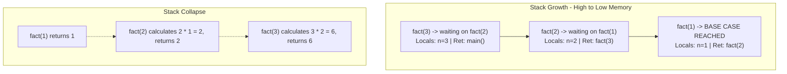
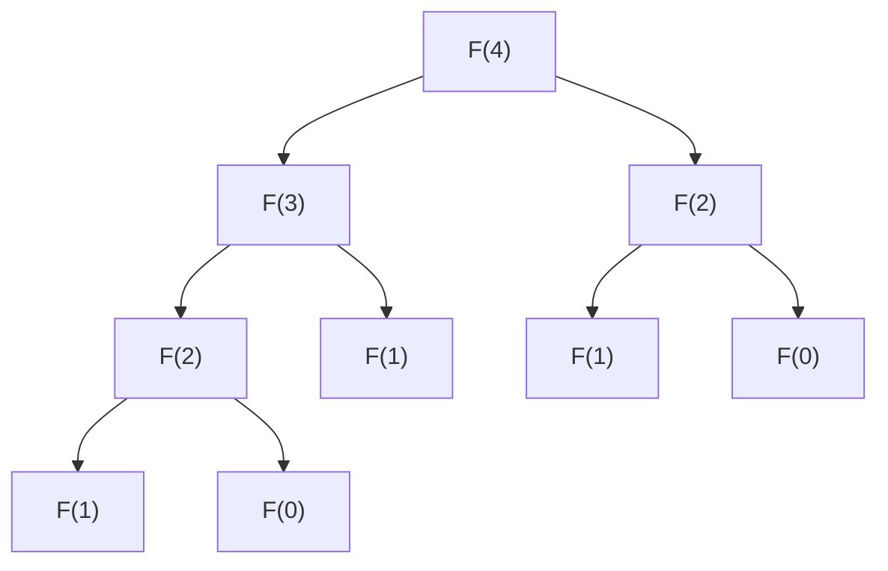

# Deep Dive: Computational Recursion

> [!abstract] Executive Summary
> **Recursion** is a foundational paradigm of computation where a solution to a problem depends on solutions to smaller instances of the same problem. Rather than advancing state via iteration (loops), recursive systems advance state by composing **self-referential functional frames** over an execution context. Mathematically grounded in **mathematical induction**, its physical realization relies heavily on the **call stack**.

---

## 1. First Principles & Mental Models

### 1.1 The Mathematical Bridge: Structural Induction
Recursion is the algorithmic realization of **Mathematical Induction**:
- **Induction**: Prove $P(0)$ is true. Assume $P(k)$ is true; prove $P(k+1)$ is true.
- **Recursion**: Provide an explicit answer for $P(0)$ (**Base Case**). Assume $P(k-1)$ is already solved correctly, and define $P(k)$ in terms of $P(k-1)$ (**Recursive Step** / *Inductive Leap*).

```
   Induction (Bottom-Up Proof)            Recursion (Top-Down Reduction)
   
        [ Base: P(0) ]                         [ Target: P(n) ]
              │                                       │
              ▼                                       ▼
        [ Step: P(1) ]                         [ Sub: P(n-1) ]
              │                                       │
              ▼                                       ▼
        [ Step: P(n) ]                         [ Base: P(0) ]
```

### 1.2 The Two Phases of Recursive Execution
Every recursive execution lifecycle consists of two distinct operational phases:
1. **The Winding Phase (Expansion / Descent):** The problem is repeatedly decomposed into smaller subproblems. Stack frames are pushed. No final answers are computed yet; the process accumulates deferred operations.
2. **The Unwinding Phase (Contraction / Ascent):** The base case is reached. Stack frames pop off one by one, returning values back to their callers, resolving deferred computations up the tree.

---

## 2. Low-Level Mechanics: The Call Stack

To master recursion, you must understand physical memory layout. A computer does not natively know "recursive functions"; it only knows **stack manipulation** and **jump instructions** (`CALL` / `RET`).

### 2.1 The Activation Record (Stack Frame)
Every function call allocates an **Activation Record** on the execution call stack containing:
- **Return Address:** Instruction pointer (`RIP`/`EIP`) to jump back to after the function exits.
- **Input Parameters:** Arguments passed into the call.
- **Local Variables:** State isolated strictly to this invocation level.
- **Frame Pointer / Base Pointer (`RBP`):** Anchor used to resolve relative memory offsets.

### 2.2 Trace Walkthrough: Memory Layout
Consider standard factorial:
```python
def fact(n: int) -> int:
    if n <= 1:
        return 1
    return n * fact(n - 1)
```

Tracing `fact(3)` on the stack:



> [!danger] Stack Overflow ($O(N)$ Space Hazard)
> Standard stacks have finite memory (typically **1MB to 8MB**). If recursion depth exceeds available stack space, the runtime raises a **Stack Overflow** (Segmentation Fault / `RecursionError`). Recursion is therefore **inherently memory-expensive** unless optimized.

---

## 3. Taxonomy of Recursion

```
Recursion Architectures
 ├── By Call Position
 │    ├── Head Recursion
 │    ├── Body Recursion
 │    └── Tail Recursion
 ├── By Tree Topology
 │    ├── Linear Recursion
 │    ├── Binary / Tree Recursion
 │    └── Nested Recursion (Ackermann)
 └── By Dispatch Mechanism
      ├── Direct Recursion
      └── Mutual / Indirect Recursion
```

### 3.1 Head vs. Body vs. Tail Recursion

| Type | Structure | Characteristics |
| :--- | :--- | :--- |
| **Head** | Recursive call occurs *before* any local processing. | Processes data on the **ascent / unwinding** phase (bottom-up). |
| **Body** | Processing occurs *both before and after* the recursive call. | State is evaluated during traversal down and up (e.g., standard mergesort). |
| **Tail** | Recursive call is the *absolute final operation* in the function. | No deferred operations. Can be compiled down to an iterative loop ($O(1)$ space). |

#### Visualizing the Structural Difference:
```python
# HEAD RECURSION (Processes on Unwind)
def print_head(n):
    if n == 0: return
    print_head(n - 1)
    print(n) # Prints: 1, 2, 3... (Ascent)

# TAIL RECURSION (Processes on Wind)
def print_tail(n):
    if n == 0: return
    print(n) # Prints: ...3, 2, 1 (Descent)
    print_tail(n - 1)
```

### 3.2 Tree (Branching) Recursion
Occurs when a function calls itself **multiple times per frame**, generating a recursion tree where depth is logarithmic or linear, but total operations grow **exponentially**.

*Example: Naive Fibonacci:*
$$F(n) = F(n-1) + F(n-2)$$


- **Time Complexity:** $\mathcal{O}(2^n)$ — Highly redundant duplicate work.
- **Space Complexity:** $\mathcal{O}(n)$ — Bound strictly to the **maximum depth** of the call tree, not total nodes.

### 3.3 Mutual (Indirect) Recursion
Function $A$ calls Function $B$, which in turn calls Function $A$.
```python
def is_even(n: int) -> bool:
    if n == 0: return True
    return is_odd(n - 1)

def is_odd(n: int) -> bool:
    if n == 0: return False
    return is_even(n - 1)
```

---

## 4. Algorithmic Complexity & Recurrences

To analyze recursive runtime, express the runtime as a **Recurrence Relation** $T(n)$, then solve it.

### 4.1 Master Theorem (Divide and Conquer)
For recurrences of the form:
$$T(n) = aT\left(\frac{n}{b}\right) + f(n)$$
Where:
- $a \ge 1$: Number of subproblems in each recursive step.
- $b > 1$: Factor by which subproblem size is reduced.
- $f(n) = \mathcal{O}(n^c)$: Work done outside the recursive calls (splitting and merging).

Compare $c$ with $\log_b(a)$:
1. **Case 1 (Leaves Dominate):** If $\log_b(a) > c \implies T(n) = \Theta(n^{\log_b a})$
2. **Case 2 (Balanced Work):** If $\log_b(a) == c \implies T(n) = \Theta(n^c \log n)$
3. **Case 3 (Root Dominates):** If $\log_b(a) < c \implies T(n) = \Theta(f(n))$

#### Classic Examples:
| Algorithm | Recurrence | Master Case | Complexity |
| :--- | :--- | :--- | :--- |
| **Binary Search** | $T(n) = T(n/2) + \mathcal{O}(1)$ | Case 2 ($a=1, b=2, c=0$) | $\mathcal{O}(\log n)$ |
| **Merge Sort** | $T(n) = 2T(n/2) + \mathcal{O}(n)$ | Case 2 ($a=2, b=2, c=1$) | $\mathcal{O}(n \log n)$ |
| **Karatsuba Multiplication**| $T(n) = 3T(n/2) + \mathcal{O}(n)$ | Case 1 ($a=3, b=2, c=1$) | $\mathcal{O}(n^{\log_2 3}) \approx \mathcal{O}(n^{1.585})$ |
| **Naive Tree Traversal** | $T(n) = 2T(n/2) + \mathcal{O}(1)$ | Case 1 ($a=2, b=2, c=0$) | $\mathcal{O}(n)$ |

---

## 5. Optimization Paradigms

### 5.1 Tail Call Optimization (TCO)
> [!tip] The Rule of TCO
> If the return value of a recursive call is **immediately returned without modification**, the compiler does not need to allocate a new stack frame. It can simply **overwrite the current stack frame** with the new parameters and jump back to the function start.

#### Standard (Non-Tail) vs. TCO-Compliant
```python
# NOT Tail Recursive: Deferred multiplication must happen after return
def fact_normal(n):
    if n <= 1: return 1
    return n * fact_normal(n - 1) # Must remember 'n' on the stack

# TAIL RECURSIVE: The recursive call returns pure, clean result
# Uses an "Accumulator" (acc)
def fact_tail(n, acc=1):
    if n <= 1: return acc
    return fact_tail(n - 1, n * acc) # No operations pending on unwind!
```

Under a TCO compiler (e.g., C/C++ via `gcc -O2`, Rust, Scala, Scheme), `fact_tail` executes in **$\mathcal{O}(1)$ auxiliary space**, transforming recursion directly into assembly `JMP` loops.

> [!warning] Python / JavaScript Notice
> - **Python** does *not* support TCO by design (to preserve full stack traces for debugging).
> - **ECMAScript 6 (JS)** standardized TCO (Proper Tail Calls), but it is primarily implemented only in WebKit/Safari.

### 5.2 Memoization (Overlapping Subproblems)
When recurrence trees contain duplicate subtrees, compute them once and cache the result:

```python
from functools import lru_cache

# Without cache: O(2^n) time | O(n) space
# With cache:    O(n) time   | O(n) space
@lru_cache(maxsize=None)
def fib(n: int) -> int:
    if n < 2:
        return n
    return fib(n - 1) + fib(n - 2)
```

---

## 6. Recursion to Iteration: The General Stack Model

Every recursive function can be transformed into an iterative equivalent. If a problem cannot be converted via a simple loop (e.g., due to tree branching or backtracking), you can simulate the OS runtime by introducing a manual **Heap-allocated Stack**.

### 6.1 Transformation Blueprint: Pre-Order Tree Traversal

```python
class TreeNode:
    def __init__(self, val=0, left=None, right=None):
        self.val = val
        self.left = left
        self.right = right

# --- RECURSIVE APPROACH (Implicit OS Call Stack) ---
def preorder_recursive(root: TreeNode) -> list[int]:
    result = []
    def traverse(node):
        if not node: return
        result.append(node.val)
        traverse(node.left)
        traverse(node.right)
    traverse(root)
    return result

# --- ITERATIVE APPROACH (Explicit Simulated Heap Stack) ---
def preorder_iterative(root: TreeNode) -> list[int]:
    if not root: return []
    result = []
    # Explicit user-space stack: Immune to Python stack depth limits
    stack = [root]
    
    while stack:
        curr = stack.pop()
        result.append(curr.val)
        # Push Right first so Left is popped and processed first
        if curr.right: stack.append(curr.right)
        if curr.left:  stack.append(curr.left)
        
    return result
```

---

## 7. Canonical Recursive Patterns

### 7.1 Pattern: State-Space Backtracking
Used when exploring combinations, permutations, or game trees. Follows the **Choose $\to$ Explore $\to$ Unchoose** invariant.

```python
def subsets(nums: list[int]) -> list[list[int]]:
    """
    Generates all subsets (power set) of unique integers.
    Time: O(n * 2^n) | Space: O(n) auxiliary recursion depth
    """
    result = []
    current_path = []

    def backtrack(index: int):
        # Base Case: Reached leaf of decision tree
        if index == len(nums):
            result.append(list(current_path)) # Deep copy snapshot
            return

        # 1. Branch: INCLUDE nums[index]
        current_path.append(nums[index]) # Choose
        backtrack(index + 1)             # Explore
        current_path.pop()               # Unchoose (Backtrack!)

        # 2. Branch: EXCLUDE nums[index]
        backtrack(index + 1)             # Explore alternative

    backtrack(0)
    return result
```

### 7.2 Pattern: Divide & Conquer
1. **Divide** problem into disjoint independent subproblems.
2. **Conquer** subproblems recursively.
3. **Combine** solutions to form final answer.

```python
def merge_sort(arr: list[int]) -> list[int]:
    # Base Case: 0 or 1 elements already sorted
    if len(arr) <= 1:
        return arr

    # 1. Divide
    mid = len(arr) // 2
    left = merge_sort(arr[:mid])
    right = merge_sort(arr[mid:])

    # 2. Combine (Conquer step)
    return merge(left, right)

def merge(left: list[int], right: list[int]) -> list[int]:
    sorted_list = []
    i = j = 0
    while i < len(left) and j < len(right):
        if left[i] <= right[j]:
            sorted_list.append(left[i])
            i += 1
        else:
            sorted_list.append(right[j])
            j += 1
    sorted_list.extend(left[i:])
    sorted_list.extend(right[j:])
    return sorted_list
```

---

## 8. Mental Checklist for Designing Recursive Algorithms

When tasked with writing a recursive function, walk through this systematic sequence:

> [!check] The 5-Step Recursive Framework
> 1. **Identify the Smallest Unit (Base Case):** What input can be evaluated trivially without recursing? What stops infinite execution?
> 2. **Define the Recursive Invariant:** What must this function return for an arbitrary input size $k$? Trust that it works for $k-1$ (leap of faith).
> 3. **Identify the Reduction Step:** How do you guarantee the arguments passed to the next frame strictly converge toward the base case?
> 4. **Determine Traversal Work Placement:** 
>    - Does work occur *before* the recursive descent (pre-order/winding)?
>    - Does work occur *after* the recursive ascent (post-order/unwinding)?
> 5. **Audit the State Invariant:** Are mutable data structures cloned or properly reset (backtracked) as frames collapse?

---

## 9. Comparative Summary Matrix

| Metric | Pure Iteration | Standard Recursion | Tail Recursion (with TCO) |
| :--- | :--- | :--- | :--- |
| **Control Flow** | Jump loops (`for`/`while`) | Function invocations | Jump instructions via compiler |
| **Stack Space** | $\mathcal{O}(1)$ | $\mathcal{O}(N)$ | $\mathcal{O}(1)$ |
| **Performance** | Low overhead | High overhead (frame alloc) | High (equivalent to loops) |
| **Cognitive Load** | High for complex structures | Low for nested/branching | Moderate |
| **Best Used For** | Linear streams, arrays | Trees, Graphs, Divide & Conquer | Functional runtimes, state transitions |

---

## Related Notes
- [[Call Stack Architecture]]
- [[Divide and Conquer Algorithms]]
- [[Dynamic Programming Mechanics]]
- [[Backtracking Invariants]]
- [[Master Theorem Reference]]
