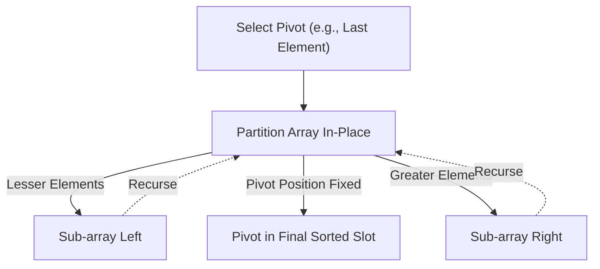
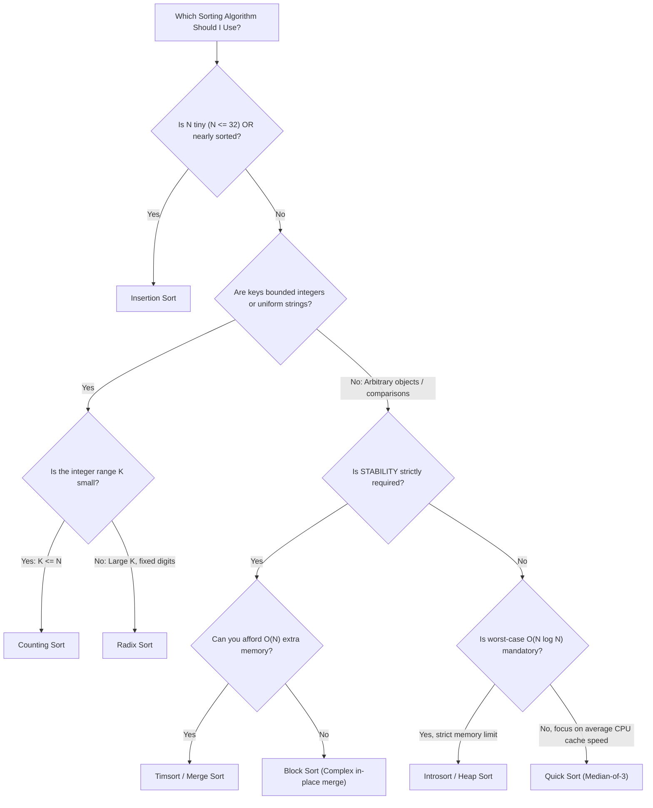

# The Comprehensive Atlas of Searching and Sorting Algorithms

> [!abstract] Executive Summary
> Sorting and searching form the bedrock of computational efficiency. A naive search in an unordered set requires linear scans $\mathcal{O}(N)$, while imposing order transforms queries to logarithmic time $\mathcal{O}(\log N)$. Understanding these algorithms requires analyzing **invariants**, **memory locality**, **stability**, and the physical mechanics of the **information-theoretic lower bound** ($\Omega(N \log N)$).

---

## 1. Foundational Properties of Sorting

Before evaluating implementations, classify algorithms along four architectural axes:

```
Algorithm Properties
 ├── 1. Stability: Does it preserve the relative order of equal keys?
 ├── 2. Space Memory Profile: In-place (O(1) auxiliary) vs. Out-of-place (O(N) allocations)?
 ├── 3. Adaptivity: Does it run faster on partially sorted input?
 └── 4. Computational Engine: Comparison-based vs. Distribution-based (Non-comparison)?
```

### 1.1 The Stability Invariant
A sort is **stable** if elements with identical keys appear in the output in the exact same order they were provided in the input.

```
Input:  [(Card: 5, "Hearts"), (Card: 5, "Spades"), (Card: 3, "Clubs")]
Stable:   [(Card: 3, "Clubs"), (Card: 5, "Hearts"), (Card: 5, "Spades")]
Unstable: [(Card: 3, "Clubs"), (Card: 5, "Spades"), (Card: 5, "Hearts")]  <-- Swapped!
```
> [!tip] Why Stability Matters
> In relational data pipelines, multi-column sorting depends on stability: sorting first by *First Name* and then stably by *Last Name* guarantees that people with identical last names remain alphabetized by their first names.

### 1.2 The Information-Theoretic Lower Bound: $\Omega(N \log N)$
Can a comparison sort ever run in $\mathcal{O}(N)$ worst-case time? **Mathematically impossible.**

- Any comparison sort can be modeled as an evaluation over a **Decision Tree** where each leaf represents a possible permutation of the input.
- For $N$ items, there are $N!$ (factorial) possible permutations.
- A binary decision tree of height $h$ has at most $2^h$ leaves.
- To distinguish between all $N!$ arrangements:
  $$2^h \ge N! \implies h \ge \log_2(N!)$$
- Using **Stirling’s Approximation** ($\ln(N!) \approx N \ln N - N$):
  $$h \ge \Omega(N \log N)$$
Therefore, **no comparison-based algorithm can beat $\mathcal{O}(N \log N)$ in the worst case.** To achieve $\mathcal{O}(N)$, you must abandon pairwise comparisons (e.g., Counting Sort, Radix Sort).

---

## 2. Searching Mechanics: Linear to Logarithmic

### 2.1 Binary Search: The Invariant Framework
Binary search is simple conceptually, but notoriously error-prone to implement (off-by-one errors, infinite loops, integer overflows). 

#### The Three Core Dialects of Binary Search:

```python
# DIALECT 1: Exact Match (Search Interval: [left, right])
def binary_search_exact(arr: list[int], target: int) -> int:
    left, right = 0, len(arr) - 1
    while left <= right:
        # Avoid integer overflow present in (left + right) // 2
        mid = left + (right - left) // 2
        if arr[mid] == target:
            return mid
        elif arr[mid] < target:
            left = mid + 1
        else:
            right = mid - 1
    return -1

# DIALECT 2: Left Bound / Bisect Left (Search Interval: [left, right))
# Finds the FIRST index where arr[index] >= target
def bisect_left(arr: list[int], target: int) -> int:
    left, right = 0, len(arr)
    while left < right:
        mid = left + (right - left) // 2
        if arr[mid] < target:
            left = mid + 1
        else:
            right = mid  # Contract search space to left side
    return left          # left points to the lower insertion index

# DIALECT 3: Binary Search on Monotonic Solution Spaces
# "Search on Answer": When you aren't searching an array, but an integer domain
def binary_search_predicate(low: int, high: int) -> int:
    # Find the minimum value x in [low, high] where is_valid(x) is True
    while low < high:
        mid = low + (high - low) // 2
        if is_valid(mid):
            high = mid      # Try to find a smaller valid answer
        else:
            low = mid + 1   # mid is invalid; must look higher
    return low
```

---

## 3. Elementary Sorts ($\mathcal{O}(N^2)$)

Elementary sorts are slow on massive datasets, but they possess low overhead and high spatial locality.

```mermaid
graph TD
    subgraph Comparison of O(N^2) Archetypes
        B["Bubble Sort"] -->|"Pairs adjacent swaps"| B_attr["Stable | Adaptive O(N) | Slowest"]
        S["Selection Sort"] -->|"Scans minimum, swaps once"| S_attr["Unstable | Non-adaptive O(N^2) | Min Swaps"]
        I["Insertion Sort"] -->|"Shifts items into sorted prefix"| I_attr["Stable | Adaptive O(N) | Fastest on small N"]
    end
```

### 3.1 Insertion Sort: The Practical Champion of Small Data
Insertion sort maintains a sorted sublist in the lower positions of the array, picking the next element and shifting it backward until placed.

```python
def insertion_sort(arr: list[int]) -> list[int]:
    # Time: O(N) Best (Already sorted) | O(N^2) Worst/Avg
    # Space: O(1) Auxiliary | Stable: YES | Adaptive: YES
    for i in range(1, len(arr)):
        key = arr[i]
        j = i - 1
        # Shift elements of arr[0..i-1] that are greater than key to the right
        while j >= 0 and arr[j] > key:
            arr[j + 1] = arr[j]
            j -= 1
        arr[j + 1] = key
    return arr
```
> [!tip] The Bedrock of Hybrid Engines
> Because Insertion Sort has negligible constant-factor overhead, low branching penalty, and optimal CPU cache locality, modern enterprise sorts (e.g., Timsort, Introsort) switch to Insertion Sort whenever sub-arrays shrink to $N \le 16$ or $N \le 32$.

---

## 4. Efficient Comparison Sorts ($\mathcal{O}(N \log N)$)

### 4.1 Merge Sort: Guaranteed Divide & Conquer
Merge sort recursively cuts the array in half, sorts each half, and performs an $\mathcal{O}(N)$ zip merge.

```
Divide Phase (Top-Down):
[38, 27, 43, 3, 9, 82, 10]
  ├── [38, 27, 43]
  │     ├── [38]
  │     └── [27, 43] -> [27], [43]
  └── [3, 9, 82, 10]
        ├── [3, 9]   -> [3], [9]
        └── [82, 10] -> [82], [10]

Conquer & Merge Phase (Bottom-Up):
  [27] + [43]       ──► [27, 43]
  [38] + [27, 43]   ──► [27, 38, 43]
  [3] + [9]         ──► [3, 9]
  [82] + [10]       ──► [10, 82]
  [3, 9] + [10, 82] ──► [3, 9, 10, 82]
  [27, 38, 43] + [3, 9, 10, 82] ──► [3, 9, 10, 27, 38, 43, 82]
```

- **Time Complexity:** Strict $\mathcal{O}(N \log N)$ in Best, Average, and Worst cases.
- **Space Complexity:** $\mathcal{O}(N)$ auxiliary memory (requires buffer allocation).
- **Stability:** **Stable** (preserves equality during merge via `<=`).

```python
def merge_sort(arr: list[int]) -> list[int]:
    if len(arr) <= 1:
        return arr
    
    mid = len(arr) // 2
    left = merge_sort(arr[:mid])
    right = merge_sort(arr[mid:])
    
    return merge(left, right)

def merge(left: list[int], right: list[int]) -> list[int]:
    merged = []
    i = j = 0
    # Stability guarantee: left[i] <= right[j] ensures left precedes right on match
    while i < len(left) and j < len(right):
        if left[i] <= right[j]:
            merged.append(left[i])
            i += 1
        else:
            merged.append(right[j])
            j += 1
    merged.extend(left[i:])
    merged.extend(right[j:])
    return merged
```

---

### 4.2 Quick Sort: In-Place Partitioning
Quick sort picks a **pivot**, re-arranges the array such that all items smaller than the pivot are on the left and all items larger are on the right, then recurses on both partitions.



#### Lomuto vs. Hoare Partition Schemes
- **Lomuto Partition:** Simpler to read; maintains a pointer to the boundary of smaller elements. Performs more swaps.
- **Hoare Partition:** Traverses from both ends with two pointers converging inward. Performs up to $3\times$ fewer swaps than Lomuto.

```python
# In-place Quick Sort using Lomuto Partitioning
def quick_sort(arr: list[int], low: int, high: int) -> None:
    # Time: O(N log N) Avg | O(N^2) Worst (bad pivot)
    # Space: O(log N) Call stack auxiliary | Stable: NO
    if low < high:
        pivot_idx = partition(arr, low, high)
        quick_sort(arr, low, pivot_idx - 1)
        quick_sort(arr, pivot_idx + 1, high)

def partition(arr: list[int], low: int, high: int) -> int:
    pivot = arr[high]  # Choosing the last element as pivot
    i = low - 1        # Boundary index of smaller elements
    
    for j in range(low, high):
        if arr[j] <= pivot:
            i += 1
            arr[i], arr[j] = arr[j], arr[i] # Swap smaller to front
            
    # Place pivot into its correct, permanent sorted position
    arr[i + 1], arr[high] = arr[high], arr[i + 1]
    return i + 1
```

> [!danger] The $\mathcal{O}(N^2)$ Worst-Case Trap
> If the input is already sorted and you pick the first or last element as pivot, the recursion tree becomes a degenerate line of depth $N$:
> $$T(N) = T(N - 1) + \mathcal{O}(N) \implies \mathcal{O}(N^2)$$
> **Production Fix:** Use **Median-of-Three** (median of `arr[low]`, `arr[mid]`, `arr[high]`) or **Randomized Pivoting**.

---

### 4.3 Heap Sort: In-Place $\mathcal{O}(N \log N)$ Guarantees
Heap sort converts the array into a **Max-Heap** in-place ($\mathcal{O}(N)$), then repeatedly extracts the maximum root element to the end of the array ($\mathcal{O}(N \log N)$).

```python
def heap_sort(arr: list[int]) -> None:
    # Time: O(N log N) All Cases | Space: O(1) Auxiliary | Stable: NO
    n = len(arr)

    # 1. Build Max-Heap (bottom-up heapify): O(N)
    for i in range(n // 2 - 1, -1, -1):
        heapify(arr, n, i)

    # 2. Extract elements one by one from end to beginning
    for i in range(n - 1, 0, -1):
        arr[i], arr[0] = arr[0], arr[i] # Swap root (max) to sorted index i
        heapify(arr, i, 0)              # Re-heapify reduced heap

def heapify(arr: list[int], n: int, root: int) -> None:
    largest = root
    left = 2 * root + 1
    right = 2 * root + 2

    if left < n and arr[left] > arr[largest]:
        largest = left
    if right < n and arr[right] > arr[largest]:
        largest = right

    if largest != root:
        arr[root], arr[largest] = arr[largest], arr[root]
        heapify(arr, n, largest) # Sift down recursively
```

---

## 5. Non-Comparison Linear Sorts ($\mathcal{O}(N)$)

When sorting keys with finite domains (integers, strings of bounded length), we bypass the $\Omega(N \log N)$ lower bound by exploiting **direct index addressing**.

```
Non-Comparison Sort Selection
 ├── Counting Sort: Keys are integers bounded in a small range [0, K].
 ├── Radix Sort: Keys are uniform-length words/integers processed digit-by-digit.
 └── Bucket Sort: Keys are uniformly distributed floating-point values in [0, 1).
```

### 5.1 Counting Sort: Array-as-Frequency-Table
Counts occurrences of each unique value, calculates cumulative prefixes, and places items directly into a target array.

```python
def counting_sort(arr: list[int]) -> list[int]:
    # Time: O(N + K) | Space: O(N + K) | Stable: YES
    if not arr: return []
    min_val, max_val = min(arr), max(arr)
    k = max_val - min_val + 1
    
    counts = [0] * k
    output = [0] * len(arr)
    
    # 1. Tally frequencies
    for num in arr:
        counts[num - min_val] += 1
        
    # 2. Compute prefix sums (running cumulative totals)
    for i in range(1, len(counts)):
        counts[i] += counts[i - 1]
        
    # 3. Build output iterating BACKWARDS to maintain STABILITY
    for num in reversed(arr):
        idx = num - min_val
        counts[idx] -= 1
        output[counts[idx]] = num
        
    return output
```

### 5.2 Radix Sort: LSD (Least Significant Digit)
Sorts numbers column-by-column starting from the least significant digit (ones place, tens place, hundreds place) using a **stable sub-sorting algorithm** (like Counting Sort).

```
Unsorted: [170, 045, 075, 090, 802, 024, 002, 066]

Pass 1 (1s Digit):
[170, 090, 802, 002, 024, 045, 075, 066]

Pass 2 (10s Digit):
[802, 002, 024, 045, 066, 170, 075, 090]

Pass 3 (100s Digit):
[002, 024, 045, 066, 075, 090, 170, 802] -> Fully Sorted!
```
- **Time Complexity:** $\mathcal{O}(D \cdot (N + B))$ where $D$ is max digit count and $B$ is the numeric base (10).
- **Space Complexity:** $\mathcal{O}(N + B)$.

---

## 6. Real-World Production Engines: Hybrid Sorts

Modern standard libraries almost never implement textbook Quick Sort or Merge Sort in isolation. They use **hybrid state machines**.

### 6.1 Timsort (Python `list.sort()`, Java `Arrays.sort()`, Rust)
- **Architecture:** Hybrid **Insertion Sort + Merge Sort**.
- **Mechanics:**
  1. Identifies naturally occurring ordered sequences called **runs** (either non-decreasing or strictly decreasing).
  2. If a run is shorter than a threshold ($minrun \in [32, 64]$), it expands it using **Binary Insertion Sort**.
  3. Merges runs using a balanced stack algorithm with **Galloping Mode** (skips comparisons using exponential binary search when one array segment dominates).
- **Profile:** $\mathcal{O}(N)$ on pre-sorted data; guaranteed $\mathcal{O}(N \log N)$ worst-case; strictly **stable**.

### 6.2 Introsort (C++ `std::sort`)
- **Architecture:** Hybrid **Quick Sort + Heap Sort + Insertion Sort**.
- **Mechanics:**
  1. Begins with **Quick Sort** for cache speed.
  2. Tracks recursion call depth. If depth exceeds $2 \log_2 N$, it detects pathological partitioning and immediately switches to **Heap Sort** to guarantee an $\mathcal{O}(N \log N)$ ceiling.
  3. For small partitions ($N < 16$), it yields execution to **Insertion Sort**.
- **Profile:** $\mathcal{O}(N \log N)$ worst-case; $\mathcal{O}(1)$ auxiliary space; **unstable**.

---

## 7. Master Comparison Matrix

| Algorithm | Best Time | Average Time | Worst Time | Aux Space | Stability | Adaptive? | Primary Advantage |
| :--- | :--- | :--- | :--- | :--- | :--- | :--- | :--- |
| **Bubble Sort** | $\mathcal{O}(N)$ | $\mathcal{O}(N^2)$ | $\mathcal{O}(N^2)$ | $\mathcal{O}(1)$ | **Yes** | Yes | Simple swap logic |
| **Selection Sort** | $\mathcal{O}(N^2)$ | $\mathcal{O}(N^2)$ | $\mathcal{O}(N^2)$ | $\mathcal{O}(1)$ | No | No | Minimizes writes/swaps |
| **Insertion Sort** | $\mathcal{O}(N)$ | $\mathcal{O}(N^2)$ | $\mathcal{O}(N^2)$ | $\mathcal{O}(1)$ | **Yes** | Yes | Elite for $N \le 32$ / nearly sorted |
| **Merge Sort** | $\mathcal{O}(N \log N)$ | $\mathcal{O}(N \log N)$ | $\mathcal{O}(N \log N)$ | $\mathcal{O}(N)$ | **Yes** | No | Stable $\mathcal{O}(N \log N)$ guarantee |
| **Quick Sort** | $\mathcal{O}(N \log N)$ | $\mathcal{O}(N \log N)$ | $\mathcal{O}(N^2)$ | $\mathcal{O}(\log N)$ | No | No | Fastest in-place average engine |
| **Heap Sort** | $\mathcal{O}(N \log N)$ | $\mathcal{O}(N \log N)$ | $\mathcal{O}(N \log N)$ | $\mathcal{O}(1)$ | No | No | Worst-case $\mathcal{O}(N \log N)$ + in-place |
| **Counting Sort** | $\mathcal{O}(N + K)$ | $\mathcal{O}(N + K)$ | $\mathcal{O}(N + K)$ | $\mathcal{O}(N + K)$ | **Yes** | No | Linear when range $K \le N$ |
| **Radix Sort** | $\mathcal{O}(D(N+B))$ | $\mathcal{O}(D(N+B))$ | $\mathcal{O}(D(N+B))$ | $\mathcal{O}(N+B)$ | **Yes** | No | Linear for fixed-width keys |
| **Timsort** | $\mathcal{O}(N)$ | $\mathcal{O}(N \log N)$ | $\mathcal{O}(N \log N)$ | $\mathcal{O}(N)$ | **Yes** | Yes | Production default (real-world data) |
| **Introsort** | $\mathcal{O}(N \log N)$ | $\mathcal{O}(N \log N)$ | $\mathcal{O}(N \log N)$ | $\mathcal{O}(\log N)$ | No | No | Production default (unstable, fast) |

---

## 8. Algorithmic Decision Architecture



---

## Related Notes
- [[The Cognitive Mechanics of Big O: Complexity Analysis Engine]]
- [[Deep Dive: Computational Recursion]]
- [[Divide and Conquer Algorithms]]
- [[Heap and Priority Queue Structures]]
- [[Dynamic Programming Mechanics]]
